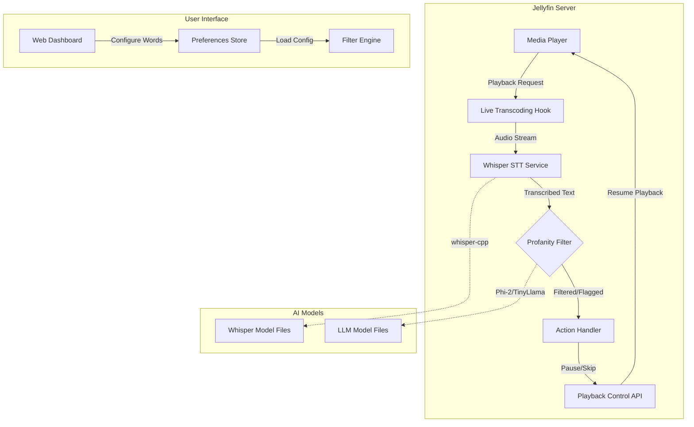
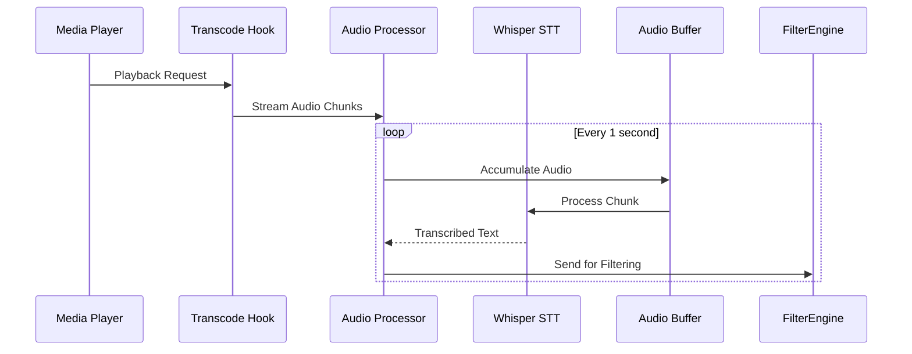
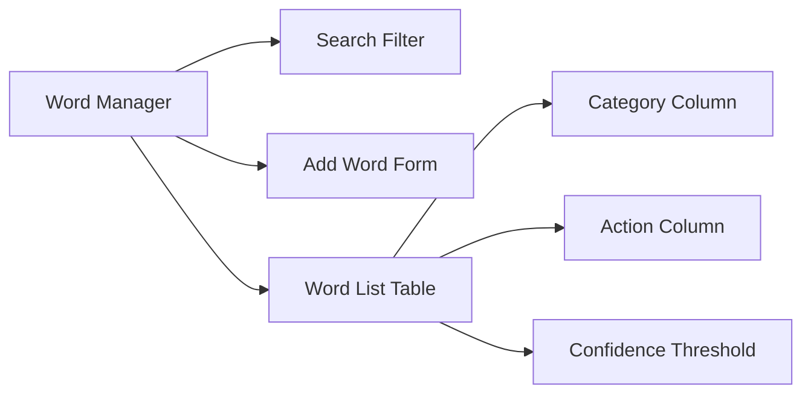
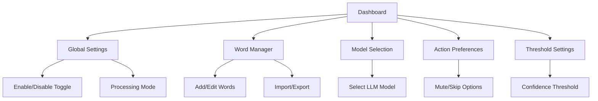
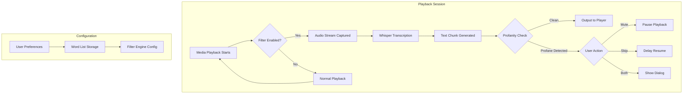

# Jellyfin Profanity Filter Plugin - Architecture Specification

## Overview

This document outlines the architecture for a Jellyfin plugin that filters profanity from recorded media playback using:
- **Whisper** (CPU-optimized) for real-time audio-to-text transcription
- **Phi-2 or TinyLlama** (lightweight LLM) for profanity detection
- Integration with Jellyfin's existing API endpoints

## System Architecture Diagram



## Component Breakdown

### 1. Project Structure

```
jellyfin-profanity-filter/
├── src/
│   ├── core/
│   │   ├── filterEngine.ts          # Main filtering logic
│   │   ├── wordMatcher.ts           # Pattern matching for variations
│   │   └── actionHandler.ts         # Mute/skip action execution
│   ├── stt/
│   │   ├── whisperService.ts        # Whisper integration
│   │   └── audioProcessor.ts        # Audio stream handling
│   ├── llm/
│   │   ├── phi2Service.ts           # Phi-2 integration
│   │   └── tinyLlamaService.ts      # TinyLlama integration
│   │   └── profanityClassifier.ts   # Text classification logic
│   ├── api/
│   │   ├── endpoints/
│   │   │   ├── transcodeHook.ts     # Live transcoding hook
│   │   │   └── filterStatus.ts      # Filter status endpoint
│   │   └── middleware/
│   │       └── auth.ts              # Plugin authentication
│   ├── ui/
│   │   ├── components/
│   │   │   ├── wordManager.tsx      # Word add/edit/delete UI
│   │   │   ├── filterSettings.tsx   # Global settings
│   │   │   └── statusIndicator.tsx   # Real-time status display
│   │   └── pages/
│   │       └── dashboard.tsx        # Main configuration page
│   ├── storage/
│   │   ├── preferences.ts           # User preference persistence
│   │   └── wordList.ts              # Filtered words storage
│   └── utils/
│       ├── logger.ts                # Logging utility
│       └── config.ts                # Configuration loader
├── models/
│   ├── whisper-cpp-ggml-q5_1.bin    # Whisper model (quantized)
│   ├── phi-2-gguf-q4_k_m.gguf      # Phi-2 model (quantized)
│   └── tinyllama-gguf-q4_k_m.gguf  # TinyLlama alternative
├── plugins/
│   └── jellyfin-profanity-filter/   # Jellyfin plugin package
├── tests/
│   ├── unit/
│   │   ├── wordMatcher.test.ts
│   │   └── filterEngine.test.ts
│   └── integration/
│       └── api.test.ts
├── docs/
│   ├── API.md                       # API documentation
│   ├── MODEL_GUIDE.md               # Model selection guide
│   └── SETUP.md                     # Installation instructions
└── package.json
```

### 2. Whisper Integration Design

#### Model Selection: whisper.cpp (CPU-optimized)

**Recommended Models:**
| Model | Size | Quantization | Use Case |
|-------|------|--------------|----------|
| `whisper-cpp-ggml-q5_1.bin` | ~470MB | Q5_K_M | Balanced accuracy/speed |
| `whisper-cpp-ggml-q4_k_m.bin` | ~430MB | Q4_K_M | Smaller footprint |

**Integration Approach:**
- Use `whisper.cpp` library for CPU inference (no GPU required)
- Implement streaming transcription with chunked audio processing
- Buffer audio in 1-second chunks for real-time processing
- Use `--faster-whisper` flag for optimized CPU performance

**Audio Processing Pipeline:**


### 3. Local LLM Integration Design

#### Model Selection: Phi-2 (Recommended)

**Why Phi-2:**
- Only 2.7B parameters (fits in 4GB RAM with quantization)
- Excellent text classification capabilities
- Open weights, no API costs
- Fast inference on CPU (~50 tokens/sec)

**Alternative: TinyLlama**
- 1.3B parameters (even smaller footprint)
- Slightly less accurate but faster
- Good fallback option

**Model Files:**
- `phi-2-gguf-q4_k_m.gguf` (~2GB compressed)
- `tinyllama-gguf-q4_k_m.gguf` (~1.3GB compressed)

**Classification Pipeline:**
```typescript
interface ProfanityCheck {
  text: string;
  timestamp: number;
  confidence: number;
}

class ProfanityClassifier {
  async classify(text: string): Promise<ProfanityCheck> {
    // Prompt engineering for classification
    const prompt = `Is the following text containing profanity? Respond only with YES or NO.\nText: ${text}`;
    
    // Stream inference
    const response = await llm.generate(prompt, {
      max_tokens: 10,
      temperature: 0.1
    });
    
    return {
      text,
      timestamp: Date.now(),
      isProfane: response.includes('YES'),
      confidence: this.calculateConfidence(response)
    };
  }
}
```

### 4. Jellyfin API Integration Points

#### Live Transcoding Hook

Jellyfin supports custom transcoding hooks via the `LiveTranscode` endpoint. We'll extend this with a new hook type:

**Endpoint:** `/plugins/profanity-filter/api/transcode-hook`

**Request Format:**
```json
{
  "mediaSourceId": "abc123",
  "itemId": "def456",
  "audioStreamIndex": 0,
  "transcodingUrl": "http://server:8096/video/...",
  "startTime": 1730570000000,
  "currentTime": 1730570001000
}
```

**Response Format:**
```json
{
  "status": "processing",
  "filterEnabled": true,
  "lastProcessedTime": 1730570001000
}
```

#### Playback Control Endpoints

**Pause Playback (Mute Action):**
```json
POST /plugins/profanity-filter/api/pause-playback
{
  "mediaSourceId": "abc123",
  "itemId": "def456"
}
```

**Skip Word (Resume After Delay):**
```json
POST /plugins/profanity-filter/api/skip-word
{
  "mediaSourceId": "abc123",
  "itemId": "def456",
  "delayMs": 5000  // Resume after 5 seconds
}
```

**Get Filter Status:**
```json
GET /plugins/profanity-filter/api/status?mediaSourceId=abc123
```

### 5. User Interface Design

#### Word Manager Component

**Features:**
- Add/edit/delete filtered words
- Case-insensitive matching
- Regex pattern support for variations (e.g., `F#ck`, `G#d`)
- Category-based organization (slang, explicit, etc.)
- Import/export word lists

**UI Layout:**


**Variation Handling:**
- Base word: `fuck`
- Variations stored as patterns:
  - `F#ck` (case variations)
  - `f*ck` (character substitutions)
  - `f_ck` (missing characters)
- Pattern matching engine handles all variations

**Configuration Page Structure:**


### 6. Data Flow Architecture



### 7. Model Recommendations Summary

#### Primary Recommendation: Phi-2

| Attribute | Value |
|-----------|-------|
| Parameters | 2.7B |
| Quantization | Q4_K_M (GGUF format) |
| Disk Size | ~2GB compressed |
| RAM Usage | ~3.5GB with context |
| Inference Speed | ~50 tokens/sec (CPU) |
| Accuracy | High for profanity detection |

#### Alternative: TinyLlama

| Attribute | Value |
|-----------|-------|
| Parameters | 1.3B |
| Quantization | Q4_K_M (GGUF format) |
| Disk Size | ~1.3GB compressed |
| RAM Usage | ~2GB with context |
| Inference Speed | ~80 tokens/sec (CPU) |
| Accuracy | Good, slightly lower than Phi-2 |

#### Whisper Model Recommendation: whisper-cpp-ggml-q5_1.bin

| Attribute | Value |
|-----------|-------|
| Parameters | N/A (fixed architecture) |
| Quantization | Q5_K_M |
| Disk Size | ~470MB |
| RAM Usage | ~2GB with context window |
| Inference Speed | ~15-30 tokens/sec (CPU i7+) |

### 8. Implementation Phases

#### Phase 1: Core Infrastructure (Week 1-2)
- [ ] Set up Jellyfin plugin project structure
- [ ] Implement audio streaming capture
- [ ] Integrate whisper.cpp for STT
- [ ] Build basic word matching engine

#### Phase 2: LLM Integration (Week 3-4)
- [ ] Implement Phi-2 integration via llama-cpp-python or GGUF loader
- [ ] Build profanity classification pipeline
- [ ] Optimize inference latency

#### Phase 3: API Integration (Week 5)
- [ ] Implement transcode hook endpoint
- [ ] Build playback control endpoints
- [ ] Add status monitoring

#### Phase 4: User Interface (Week 6-7)
- [ ] Create word manager component
- [ ] Build dashboard configuration page
- [ ] Implement real-time status display

#### Phase 5: Testing & Optimization (Week 8)
- [ ] Unit tests for all components
- [ ] Integration testing with Jellyfin
- [ ] Performance optimization
- [ ] Documentation completion

### 9. Technology Stack

| Component | Technology | Reason |
|-----------|------------|--------|
| Plugin Framework | Jellyfin API v10+ | Native integration |
| STT Engine | whisper.cpp | CPU-optimized, open source |
| LLM Engine | llama-cpp-python / GGUF | Efficient inference |
| Language | TypeScript | Type safety, ecosystem |
| UI Framework | React + Material UI | Standard web components |
| Storage | SQLite (via Jellyfin) | Persistent preferences |

### 10. Security Considerations

- [ ] All API endpoints require authentication
- [ ] Model files stored in protected plugin directory
- [ ] No external API calls (fully local processing)
- [ ] User preferences encrypted at rest
- [ ] Input sanitization for all user inputs

---

**Next Steps:**
1. Review architecture specification
2. Confirm technology choices
3. Begin Phase 1 implementation
